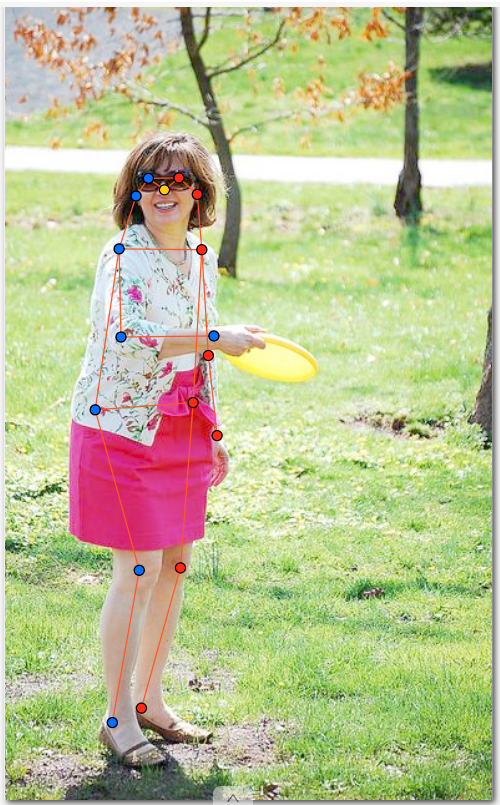
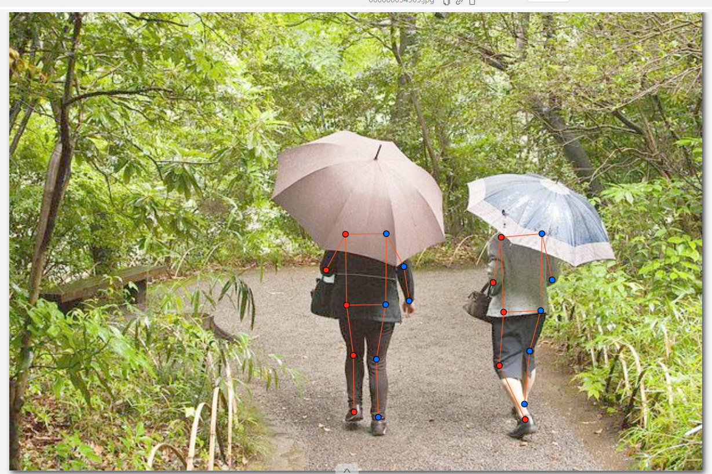
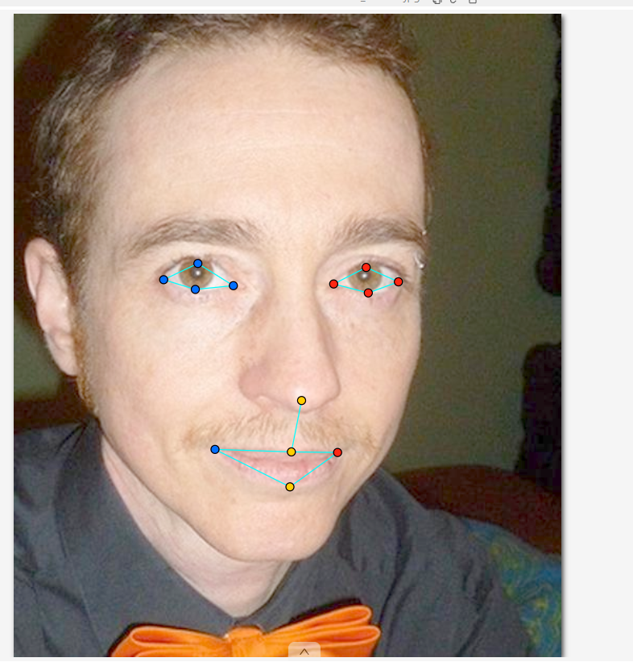
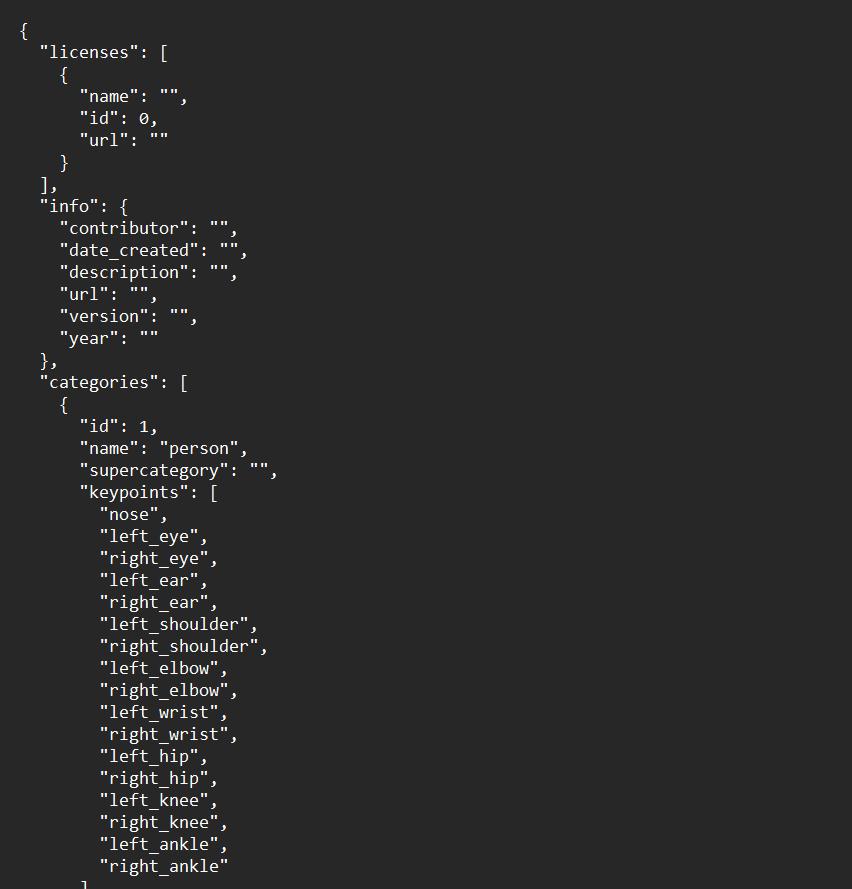

# Báo cáo cá nhân — Báo cáo cá nhân — PhamLamAnh-2A202603029

Đổi tên file theo quy tắc `MSSV_HoTen.md`. Ví dụ: `20241234_NguyenVanAn.md`.

Dữ liệu: 12 ảnh người COCO val2017 (Lin et al., 2014) và 8 ảnh chân dung Wikimedia Commons, chỉ dùng trong lớp.

## 0. Thông tin học viên

- Họ tên: Phạm Lâm Anh
-MSSV: 2A202603029
-Email: lamanhpham0@gmail.com
-Link repository: https://github.com/sui462003/K5-L2-DAY04-PhamLamAnh-2A202603029-KeypointPose
-Phiên bản CVAT (Help → About): 
-Máy: hệ điều hành Windows · RAM 16 GB · chạy CVAT chế độ [đầy đủ / lite]: đầy đủ
-Bộ ảnh (src/exports/assignment.json do lab.py setup tạo): có
-Giờ bắt đầu: 17:50
-Giờ kết thúc: 18:55

1. Kiểm tra label (CP0)
Label	Kiểu	Số điểm	Tên điểm đúng bảng của lab?	Đúng thứ tự?	Số cạnh
person	Skeleton	17	Có	Có	19
face	Skeleton	13	Có	Có	13

Mẫu person dựng theo người quay mặt về camera (các điểm left_* nằm bên phải khung mẫu)? Có

Cách đổi cờ occluded / outside cho một điểm trên phiên bản CVAT này (một câu):

Chọn skeleton, bấm vào đúng điểm cần đổi (hoặc chọn điểm đó trong danh sách bên phải), rồi bấm O (hoặc biểu tượng con mắt/occluded) để đặt occluded, hoặc H/biểu tượng outside để đặt outside [kiểm lại phím tắt trên bản CVAT của bạn].

## 2. Số lượng đã gán và thời gian (CP1, CP2)

Nhóm ảnh	Số ảnh	Số skeleton đã gán	Số người dưới 60 px (không gán)	Số poster / gương / màn hình bỏ qua	Thời gian (phút)
easy	5	5	0	2	10
occluded	3	6	0	0	9
back	2	4	3	0	6
small	1	2	6	0	3
crowd	1	3	5	0	5
faces	8	8	—	0	12
Tổng	20	28 (20 người + 8 mặt)	14	2	45

Ghi chú: số người dưới 60 px, số poster / ảnh treo tường và số phút là ước lượng (đếm bằng mắt từ ảnh và chia theo tổng thời gian làm bài 17:50 đến 18:55), không phải số đo chính xác.

Số ảnh người đã xong ở mốc phút 105: 10 / 10
Thời gian thực tế (phút, ước lượng): CP1 33 · CP2 12 · CP3 12 (phần còn lại khoảng 8 phút dành cho xuất file, tự kiểm và chuyển job sang completed)
Ảnh tốn thời gian nhất là ảnh nào, vì sao?

Ảnh 000000326480.jpg (nhóm crowd, khoảng 5 phút). Ảnh có 3 người đứng sát nhau, tay và thân chồng lên nhau nên phải xác định điểm nào thuộc người nào. Có 5 điểm bị che nhưng vẫn ước lượng được (v = 1) ở người giữa và một số điểm tay, tai phải đặt v = 0, nên phải đổi cờ từng điểm. Ngoài ra nền ảnh còn khoảng 5 người nhỏ không gán.

3. Bảng ca khó (CP1, CP2)

Cờ ở cột "Cờ đã chọn" đọc trực tiếp từ file xuất. Cột "Phân vân giữa" và "Lý do" là phần mình suy ra từ nội dung ảnh, hãy sửa lại cho đúng ý bạn nếu khác.

Ảnh	Người / mặt	Điểm	Cờ đã chọn	Phân vân giữa	Lý do chọn
000000043968.jpg	cậu bé trượt snowboard (người 1)	left_knee, right_knee, left_ankle, right_ankle	2	Giữ nguyên hay đổi trái/phải (lr_swap)	Hông trái nằm bên phải ảnh nhưng gối và cổ chân trái lại nằm bên trái ảnh (script cảnh báo). Cần đối chiếu lại tư thế đứng nghiêng khi trượt ván
000000054909.jpg	hai người che ô, quay lưng (người 1, 2)	nose, left_eye, right_eye, left_ear, right_ear	0	v = 1 hay v = 0	Đầu bị ô che hoàn toàn nên không đoán chắc được vị trí mắt, tai; chọn v = 0
000000147780.jpg	cậu bé sau con ngựa (người 1)	khuỷu trái, hai cổ tay, hai hông, hai gối, cổ chân trái	0	v = 1 hay v = 0	Nửa thân dưới bị ngựa và xe che, không có căn cứ chắc chắn để ước lượng
000000326480.jpg	nhóm ba người đứng gần nhau (người 2)	left_ear, right_ear, left_elbow, left_knee, right_knee	1	v = 1 hay v = 2	Bị người đứng cạnh che một phần nhưng vị trí vẫn ước lượng chắc nên chọn v = 1
face_324513.jpg	khuôn mặt đeo kính râm gương	8 điểm mắt	0	v = 1 hay v = 0	Mắt bị kính râm che hoàn toàn nên chọn v = 0; xem lại mục 4 vì kính râm thường tính là v = 1

4. Bảng tự review (CP3)

Đi từ ảnh cuối về ảnh đầu. 5 ảnh người (ít nhất 2 ảnh back hoặc crowd) và 3 ảnh mặt. Ít nhất 8 dòng, kể cả dòng ok. Ghi lỗi trước, sửa sau.

Mã lỗi dùng đúng một trong: lr_swap, vis_flag, position, missing, extra, ok.

Ảnh	Người / mặt	Điểm	Mã lỗi	Ghi chú	Đã sửa?
face_79367.jpg	mặt 1	cả 13 điểm	ok	Tất cả v = 2, num_keypoints = 13	Không cần
face_324513.jpg	mặt 1	8 điểm mắt	vis_flag	Mắt dưới kính râm gương đặt v = 0; có thể phải là v = 1	[ĐIỀN]
face_185015.jpg	mặt 1	mouth_right	ok	Ngón tay che khóe miệng, đặt v = 1	Không cần
000000469061.jpg	người 2 (trẻ quay lưng)	mũi, mắt, tai	ok	Quay lưng nên 5 điểm đầu v = 0, num_keypoints = 12	Không cần
000000326480.jpg	người 2	tai, khuỷu trái, gối	ok	5 điểm v = 1 do bị che, 2 điểm v = 0	Không cần
000000307757.jpg	người 1	đầu, chân	ok	Quay lưng, mũi, mắt v = 0	Không cần
000000054909.jpg	người 2	left_ankle, right_ankle	ok	Cổ chân trái nằm bên phải ảnh trong khi các cặp trên thì ngược lại; chấp nhận được nếu hai chân đang bước	[ĐIỀN]
000000043968.jpg	người 1	gối, cổ chân	lr_swap	Trùng với cảnh báo của script; hông trái ở bên phải ảnh nhưng gối trái ở bên trái ảnh	[ĐIỀN]

Tổng hợp số lỗi theo mã:

lr_swap	vis_flag	position	missing	extra	ok
1	1	0	0	0	6

Điểm còn phân vân giữa v = 1 và v = 0 (ghi cả hai lựa chọn và lý do chọn):

Đầu hai người che ô trong 000000054909.jpg: chọn v = 0 vì không thấy mặt và tai; v = 1 chỉ hợp lý nếu có thể ước lượng chắc vị trí đầu theo thân.
Mắt đeo kính râm gương trong face_324513.jpg: chọn v = 0 vì kính che hẳn mắt; theo quy tắc "bị che nhưng ước lượng chắc" thì có thể phải là v = 1.

5. Kiểm file xuất và kết quả tự kiểm (CP4)

Tự kiểm tay trong file JSON:

File	Người / mặt kiểm (ảnh, thứ tự)	Số phần tử keypoints	Điểm outside ra v = 0, occluded ra v = 1?	num_keypoints khớp?
PHAMLAMANH_persons.zip	000000054909.jpg, người 1	51	Có: 6 điểm đầu và cổ tay trái ra v = 0; ảnh này không có điểm occluded	Có (11 điểm v > 0)
PHAMLAMANH_persons.zip	000000326480.jpg, người 2	51	Có: 5 điểm occluded ra v = 1, 2 điểm outside ra v = 0	Có (10 + 5 = 15)
PHAMLAMANH_faces.zip	face_185015.jpg	39	Có: mouth_right ra v = 1; không có điểm v = 0	Có (13)

Sau khi xuất, CVAT ghi occluded thành v = 1 và outside thành v = 0. Tọa độ của điểm outside trong file là tọa độ cũ, ví dụ 8 điểm mắt v = 0 của face_324513.jpg vẫn có tọa độ như 343.08, 248.07 (script ghi nhận 81 điểm v = 0 vẫn mang tọa độ cũ, đúng với CVAT 2.x; chuẩn COCO ghi 0, 0 nhưng điểm v = 0 bị bỏ qua khi huấn luyện và khi chấm).

Hai job đã chuyển sang completed trên CVAT? [ĐIỀN: Có / Không]

Dán phần TÓM TẮT in ra từ src/check_submission.py:

text
=== PHAMLAMANH_persons.zip (label `person`) ===
  [CẢNH BÁO] 000000043968.jpg #1: cặp knee, ankle nằm ngược phía so với các cặp còn lại. Có thể đổi trái/phải một cặp (`lr_swap`), hoặc tay / chân bắt chéo thật: kiểm lại.

=== PHAMLAMANH_faces.zip (label `face`) ===

----- TÓM TẮT (dán vào báo cáo mục 5) -----
- File person: PHAMLAMANH_persons.zip
  Số ảnh: 12 · số skeleton `person`: 20 · mỗi annotation 51 số
  Skeleton theo ảnh: 000000007281=2, 000000043968=1, 000000054909=2, 000000137767=1, 000000147780=2, 000000150500=1, 000000201702=1, 000000307757=2, 000000326480=3, 000000360811=2, 000000469061=2, 000000558066=1
  Cờ v: v=2 247 (73%) · v=1 20 (6%) · v=0 73 (21%)
  num_keypoints trung bình: 13.3
- File face: PHAMLAMANH_faces.zip
  Số ảnh: 8 · số skeleton `face`: 8 · mỗi annotation 39 số
  Skeleton theo ảnh: face_122747=1, face_185015=1, face_261458=1, face_300399=1, face_324513=1, face_436791=1, face_514826=1, face_79367=1
  Cờ v: v=2 94 (90%) · v=1 2 (2%) · v=0 8 (8%)
  num_keypoints trung bình: 12.0
- Ghi chú: 81 điểm v = 0 vẫn mang tọa độ cũ (CVAT 2.x xuất như vậy; chuẩn COCO ghi 0, 0). Không phải lỗi: điểm v = 0 bị bỏ qua khi huấn luyện và khi chấm.
- Số [LỖI]: 0 · số [CẢNH BÁO]: 1
Kết quả: ĐẠT (đọc lại từng cảnh báo ở trên)

Các [CẢNH BÁO] còn giữ nguyên và lý do:

Còn 1 cảnh báo ở 000000043968.jpg #1 (cặp knee, ankle nằm ngược phía). [ĐIỀN: sau khi xem lại ảnh, đây là chân bắt chéo thật nên giữ nguyên / hoặc đã sửa lr_swap rồi xuất lại]

## 6. Ảnh chụp màn hình

1. Label `person` trong label constructor (đủ 17 điểm có tên):

   

2. Một người quay lưng đã gán, cờ đã đặt:

   

3. Một khuôn mặt đã gán 13 điểm, phóng to vùng mắt:

   

4. Một đoạn JSON xuất của một người:

   

Nguồn ảnh: COCO val2017 / Wikimedia Commons.

## 7. Tự đánh giá

1:Lỗi bạn mắc nhiều nhất hôm nay, và cách bạn sẽ tránh ở dự án thật: gợi ý nếu đúng với bạn: nhầm trái/phải ở chân bắt chéo và chấp nhận điểm gợi ý của model mà chưa soát; tránh bằng cách luôn tự hỏi "bên trái của chính người trong ảnh" trước khi đặt điểm, và review từng cặp trái/phải sau khi hoàn thành.
2:Một quy tắc bạn đề xuất thêm vào guideline (kèm ảnh ví dụ nếu có): kính râm hoặc kính gương che mắt thì đặt v = 1 cho 8 điểm mắt, không đặt v = 0.
Lý do trong báo cáo là mắt vẫn nằm ở vị trí xác định sau tròng kính và ước lượng chắc được từ viền kính, sống mũi, lông mày. Mắt có sigma nhỏ nên OKS phạt nặng, vì vậy việc mọi người gán thống nhất là quan trọng. Ảnh ví dụ là face_324513.jpg.
3:Nhãn của bạn đi vào model ở đâu? Chọn một lỗi bạn đã sửa và nói nó sẽ làm model học sai thế nào (heatmap, trọng số trong loss, hay bước lật ảnh): Ví dụ với lỗi lr_swap ở cặp knee/ankle: heatmap của left_knee sẽ có đỉnh ở chân phải của người trong ảnh, nên model học gán nhãn "trái" cho chân phải. Khi lật ảnh để tăng dữ liệu, cặp trái/phải được đổi tên, nên nhãn sai càng bị khuếch đại ngược chiều

   ...

## 8. Khó khăn và lỗi kỹ thuật

...

## Bonus (nếu làm)

B1 — 3 ảnh người khó thêm
Ảnh	Số skeleton	Số người dưới 60 px	Ca khó nhất
000000005294.jpg	3	khoảng 6 (người đi bộ ở xa, nền phố)	Ảnh đen trắng, hai người ngồi ghế đọc báo, tờ báo che gần hết thân trên nên người 1 chỉ có 6 điểm v > 0 (11 điểm v = 0)
000000196853.jpg	3	0	Ảnh bị cắt ngang đùi nên hai gối, hai cổ chân của hai người phía trước đặt v = 0; người phía sau quay lưng, bị che gần hết, 10 điểm v = 0
000000213506.jpg	2	khoảng 3 (người ở xa phía bên phải)	Cô gái quay lưng, hai tay giơ ra sau đầu nên 5 điểm đầu v = 0; người phụ nữ bên cạnh đứng nghiêng, hai chân gần nhau nên dễ nhầm trái/phải (gối và cổ chân trái nằm bên trái ảnh dù mắt trái ở bên phải ảnh)

Kết quả `src/check_submission.py` cho `HoVaTen_bonus_persons.zip`:

== Tự kiểm (src/check_submission.py)

=== D:\K5-L2-DAY04-PhamLamAnh-2A202603029-KeypointPose\src\exports\PHAMLAMANH_persons.zip (label `person`) ===
  [CẢNH BÁO] 000000043968.jpg #1: cặp knee, ankle nằm ngược phía so với các cặp còn lại. Có thể đổi trái/phải một cặp (`lr_swap`), hoặc tay / chân bắt chéo thật: kiểm lại.

=== D:\K5-L2-DAY04-PhamLamAnh-2A202603029-KeypointPose\src\exports\PHAMLAMANH_faces.zip (label `face`) ===

----- TÓM TẮT (dán vào báo cáo mục 5) -----
- File person: PHAMLAMANH_persons.zip
  Số ảnh: 12 · số skeleton `person`: 20 · mỗi annotation 51 số
  Skeleton theo ảnh: 000000007281=2, 000000043968=1, 000000054909=2, 000000137767=1, 000000147780=2, 000000150500=1, 000000201702=1, 000000307757=2, 000000326480=3, 000000360811=2, 000000469061=2, 000000558066=1
  Cờ v: v=2 247 (73%) · v=1 20 (6%) · v=0 73 (21%)
  num_keypoints trung bình: 13.3
- File face: PHAMLAMANH_faces.zip
  Số ảnh: 8 · số skeleton `face`: 8 · mỗi annotation 39 số
  Skeleton theo ảnh: face_122747=1, face_185015=1, face_261458=1, face_300399=1, face_324513=1, face_436791=1, face_514826=1, face_79367=1
  Cờ v: v=2 94 (90%) · v=1 2 (2%) · v=0 8 (8%)
  num_keypoints trung bình: 12.0
- Ghi chú: 81 điểm v = 0 vẫn mang tọa độ cũ (CVAT 2.x xuất như vậy; chuẩn COCO ghi 0, 0). Không phải lỗi: điểm v = 0 bị bỏ qua khi huấn luyện và khi chấm.
- Số [LỖI]: 0 · số [CẢNH BÁO]: 1
Kết quả: ĐẠT (đọc lại từng cảnh báo ở trên)
PS D:\K5-L2-DAY04-PhamLamAnh-2A202603029-KeypointPose>

### B2 — 5 ảnh khuôn mặt đen trắng / hồng ngoại

Số liệu tính trực tiếp từ file JSON: 5 ảnh, 5 skeleton face, mỗi annotation 39 số; v = 2: 55, v = 1: 6, v = 0: 4; num_keypoints trung bình: 12.2.

Ảnh không màu khó hơn ở điểm nào? Kính râm trên ảnh hồng ngoại có còn là v = 1 không?
Ảnh không màu khó hơn ở các điểm sau:

Môi và miệng: môi gần như cùng tông xám với da nên khó xác định mouth_left, mouth_right, lip_upper, lip_lower. Ba ảnh có râu hoặc ria mép che môi: face_274219.jpg và face_317330.jpg đặt 3 điểm miệng v = 1 (ria che), còn face_68290.jpg (râu dài che kín miệng) đặt cả 4 điểm miệng v = 0.
Mắt: không có màu để phân biệt tròng đen với lòng trắng, nên các điểm eye_inner, eye_outer dễ lệch vài pixel; ảnh face_102517.jpg có gọng kính đen dày đè lên viền mắt.
Ảnh cũ, có hạt, tương phản thấp: như face_274219.jpg và face_280788.jpg, nên đường viền mí mắt và khóe miệng không rõ nét.

Kính râm: face_317330.jpg đeo kính tối màu nhưng vẫn nhìn thấy mắt qua tròng kính nên mắt đặt v = 2. Kính râm hoàn toàn đục (như face_324513.jpg ở bài chính) thì mắt nên là v = 1, vì vị trí mắt vẫn ước lượng chắc.

Một điểm cần xem lại: face_102517.jpg có ria mép che môi trên nhưng 4 điểm miệng đều v = 2, trong khi face_274219.jpg và face_317330.jpg cũng có ria mép lại đặt v = 1. Nên thống nhất một cách chọn cho cả ba ảnh.

...

### B3 — Model so với nhãn của tôi (không tính điểm)

- Demo đã dùng:
- Ảnh đã thử:

1. Model có trả điểm cho khớp bị che, hay khớp ngoài ảnh không? Confidence ở các điểm đó thế nào?

   ...

2. Với người quay lưng, model có đổi trái/phải không?

   ...

3. Bộ điểm của model có giống 17 điểm COCO không?

   ...

## 9. Tài liệu tham khảo và công cụ AI đã dùng

Lin et al., 2014, Microsoft COCO: Common Objects in Context; COCO Keypoints 1.0.
CVAT, tài liệu của lab (docs/GUIDELINE.md, docs/CVAT_CHEATSHEET.md, docs/COCO_KEYPOINTS.md).
mmpose HRNet-w32 (Nuclio function pth-mmpose-hrnet32) để gợi ý điểm ban đầu; mình chỉnh tay và review lại toàn bộ.
